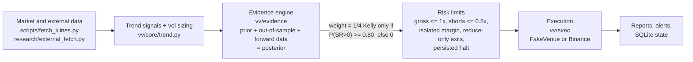

<p align="center"></p>

# ETH-AI: Advanced Ethereum Trading Bot
> ⚠️ Under rework: earlier AI/performance claims were unsubstantiated and have been removed. See docs/PRODUCTION_PLAN.md.

Research only. This project is for backtesting and education and is not financial advice or a promise of profit.

## Current architecture

The sections below still describe the earlier LSTM + XGBoost design. The live code path is the evidence-weighted trend book in `vv/` (see `docs/STATUS.md` and `CLAUDE.md`):



`python -m vv.runner --mode dry|testnet|live` runs this chain as a daily job. Live mode also needs the owner's explicit approval and `VV_LIVE_CONFIRM=yes`.

## 🚀 Project Overview
**ETH-AI** is a sophisticated quantitative trading bot designed to trade Ethereum (ETH) using deep learning and alternative data. Unlike simple moving-average bots, it uses a **Metamodel** approach—combining specific strengths of different AI architectures to predict market moves.

## 🧠 The Brain (AI Strategy)
The bot uses an **Ensemble Model** that dynamically weights two distinct trading engines based on their recent performance:

1.  **LSTM (Deep Learning)**:
    - *Strength*: Capturing complex, non-linear time-series patterns.
    - *Role*: The "Intuition" engine that looks at price history sequences.
2.  **XGBoost (Gradient Boosting)**:
    - *Strength*: Handling regime changes and tabular features.
    - *Role*: The "Logic" engine that analyzes hard metrics (Gas Fees, RSI levels).

**How It Decides:**
The **Walk-Forward Engine** tests both models every year. If LSTM did better in 2023, it gets more voting power in 2024.

---

## 📊 The Data (Features)
We feed the AI a 360-degree view of the market using **411 distinct features**:

### 1. Market Data (Binance)
- **Price Action**: Open, High, Low, Close, Volume.
- **Technicals**: RSI, MACD, Bollinger Bands, ATR (Volatility), etc.
- *Purpose*: Teaches the bot standard technical analysis patterns.

### 2. Sentiment Analysis (News)
- **Source**: Historic crypto news headlines.
- **Tech**: `SentenceTransformer` (BERT-based) converts text into numerical vectors (Embeddings).
- *Purpose*: Allows the bot to "read" the news and detect fear/hype cycles.

### 3. On-Chain Data (Infura)
- **Metric 1: Base Fee Trends**: High fees often signal network congestion (tops/capitulation).
- **Metric 2: Gas Used Ratio**: Measures network utilization.
- *Purpose*: Gives the bot "fundamental" insight into the Ethereum network health.

---

## 🛠️ How to Use

### 1. Setup
You need Python 3.8+ and the required libraries.

```bash
pip install -r requirements.txt
```

### 2. Run the Dashboard
The project includes a Streamlit dashboard to visualize performance.

```bash
streamlit run dashboard.py
```

### 3. Run Training
To retrain the models from scratch:

```bash
python main.py --mode train
```

## 🛠️ How to Use

### 1. Setup
You need Python 3.8+ and the required libraries.

```bash
pip install -r requirements.txt
```

### 2. Run the Dashboard
The project includes a Streamlit dashboard to visualize performance.

```bash
streamlit run dashboard.py
```

### 3. Run Training
To retrain the models from scratch:

```bash
python main.py --mode train
```

---

## 📦 Project Structure
- **`src/`**: Source code for data fetching and model logic.
- **`data/`**: Historical datasets (parquet files).
- **`models/`**: Saved model weights.
- **`notebooks/`**: Jupyter notebooks for research.

---

## ⚠️ Disclaimer
This software is for educational purposes only. Cryptocurrency trading carries significant risk. The authors are not responsible for any financial losses.

## 📉 Trading Philosophy
- **No Shorting**: We only buy ETH (Long) or hold Cash. We never bet against the market.
- **No Leverage**: We trade 1:1 with our capital.
- **Capital Preservation**: If the model is unsure, it stays in Cash (USDC).

## Limitations and risk controls

Backtests can overfit, market regimes change, and live trading carries loss risk. The documented strategy avoids shorting and leverage.

## Visual assets

The banner illustration was generated from a written brief (`docs/assets/briefs/`, with the references it drew on); its sidecar `docs/assets/hero-art.png.json` records the prompt. Text is set in real type by `docs/assets/tools/compose_banner.py`. `docs/assets/social-preview.png` (1280x640) is for the repository's social preview.
